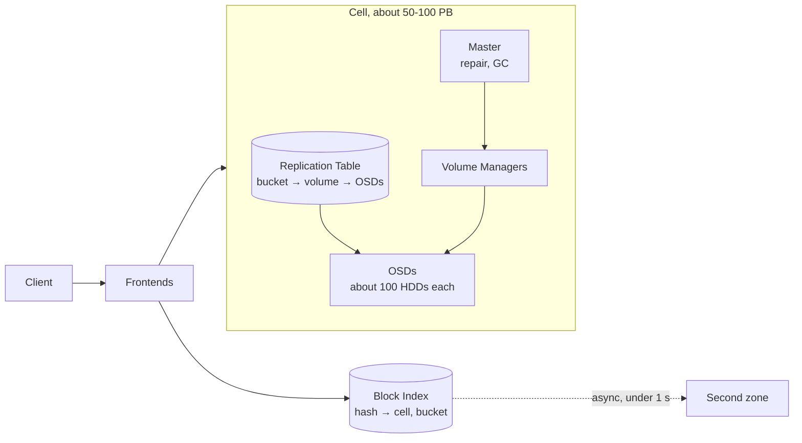

# Dropbox Magic Pocket: repatriation from AWS S3

IT457 Cloud Computing case study, Dhirubhai Ambani University.
Team: 202611054, 202611032, 202611009.

Between 2013 and 2016 Dropbox moved more than 90% of its user files, roughly 600 PB, off
Amazon S3 and onto **Magic Pocket**, a blob store it designed, wrote and runs in leased
co-location space. This repo holds our research notes, the weekly deliverables, and later the
cost model we build to test whether that decision holds up.

**Week 1 brief:** [docs/week1/IT457_Week1_MagicPocket_Brief.pdf](docs/week1/IT457_Week1_MagicPocket_Brief.pdf)

## The case in five numbers

| | | Source |
| :--- | :--- | :--- |
| Data moved in-house | over 90% of ~600 PB, by 7 Oct 2015 | Dropbox tech blog |
| Infrastructure cost cut | $39.5M (2016) + $35.1M (2017) | S-1 |
| Gross margin | 33% (2015) → 54% → 67% (2017) | S-1 |
| Capex over the same years | about $219M (2015–2017) | S-1 |
| Durability | 12 nines published, 11 committed in the S-1, 27 in Dropbox's own model | blog, S-1 |

The $74.6M "savings" figure that most write-ups quote is the sum of the two S-1 lines above.
It sits in cost of revenue and does not include the capex, which is why the case is still
argued about (see [docs/cost-and-outcomes.md](docs/cost-and-outcomes.md)).

## Why Dropbox left S3

- **One narrow workload.** Immutable blocks up to 4 MB, written once, mostly read while new:
  over 40% of reads hit data less than a day old.
- **Storage was the product.** Storage is most of Dropbox's cost of revenue, so the S3 bill
  effectively set its gross margin.
- **Scale.** About 500 PB by 2015, up from 40 PB in 2012. At that size a dedicated storage team
  and custom hardware pay for themselves.
- **Control.** Owning the stack meant choosing the disk format, erasure code, server density
  and repair policy, none of which S3 exposes.

It was not a full exit. Dropbox still uses AWS for the remaining data and for European
business customers, whose files have been stored on AWS in Germany since 2016.

## Architecture



- Files are split into blocks of up to 4 MB, keyed by SHA-256, packed into 1 GB buckets, which
  are grouped into volumes on storage servers (OSDs).
- New data is replicated four ways. Full volumes are closed and erasure-coded with
  LRC-(12,2,2), about 1.33× overhead.
- Every block is in at least two of three US zones.
- Older data moves to a cold tier: two halves in two regions plus their XOR in a third, which
  saves 25% of disk compared with full cross-region copies.
- Six background verifiers keep checking the data. They account for more than half of all disk
  and database load.

More detail, including the write path and the hardware generations, is in
[docs/architecture.md](docs/architecture.md).

## Migration timeline

| When | What |
| :--- | :--- |
| Summer 2013 | Project starts |
| Aug 2014 | Dark launch: writes go to both S3 and Magic Pocket |
| 27 Feb 2015 | Magic Pocket starts serving users |
| 30 Apr 2015 | Bulk transfer ("BASE Jump") begins, peaks above 0.5 Tb/s |
| 7 Oct 2015 | 90% of data served in-house, three weeks ahead of target |
| Q4 2016 | Last duplicate copies on S3 removed |

Full timeline up to 2026: [docs/timeline.md](docs/timeline.md).

## Project plan

| Week | Work | Deliverable | Status |
| :--- | :--- | :--- | :--- |
| 1 | Find primary sources; extract architecture, cost and outcome data | Summary of sources and salient points | Done |
| 2 | Case analysis: architecture, problem, solution | 10-page report, exercise plan, team roles | Next |
| 3 | Cost and repatriation exercise: price the workload on two cloud providers, build an on-prem TCO, measure replication vs erasure-coding overhead | Results added to the report | |
| 4 | Final report | Report | |
| 5 | Viva | | |

## Repository layout

```
.
├── README.md
├── docs/
│   ├── architecture.md         components, write path, redundancy, hardware
│   ├── cost-and-outcomes.md    S-1 and 10-K numbers, and the a16z vs Quinn debate
│   ├── timeline.md             2007 to 2026
│   ├── sources.md              annotated sources with links
│   └── week1/
│       ├── IT457_Week1_MagicPocket_Brief.pdf
│       ├── IT457_Week1_MagicPocket_Brief.tex
│       └── draft/              first version of the Week 1 summary
└── .gitignore
```

Week 2 and 3 folders will be added as the work starts.

## Building the Week 1 PDF

The brief uses the `tufte-handout` class.

```bash
cd docs/week1
tectonic IT457_Week1_MagicPocket_Brief.tex
```

`pdflatex` or `latexmk` work too if the `tufte-latex` package is installed.

## Main sources

- Dropbox tech blog: [Scaling to exabytes and beyond](https://dropbox.tech/infrastructure/magic-pocket-infrastructure) (2016),
  [Inside the Magic Pocket](https://dropbox.tech/infrastructure/inside-the-magic-pocket) (2016),
  [Pocket watch](https://dropbox.tech/infrastructure/pocket-watch) (2016),
  [Cold storage](https://dropbox.tech/infrastructure/how-we-optimized-magic-pocket-for-cold-storage) (2019)
- Dropbox [Form S-1](https://www.sec.gov/Archives/edgar/data/0001467623/000119312518055809/d451946ds1.htm) (2018)
- F. Agriel, [QCon SF 2022 talk, InfoQ write-up](https://www.infoq.com/articles/dropbox-magic-pocket-exabyte-storage/) (2023)

All 16 sources, with what we used each one for: [docs/sources.md](docs/sources.md).
