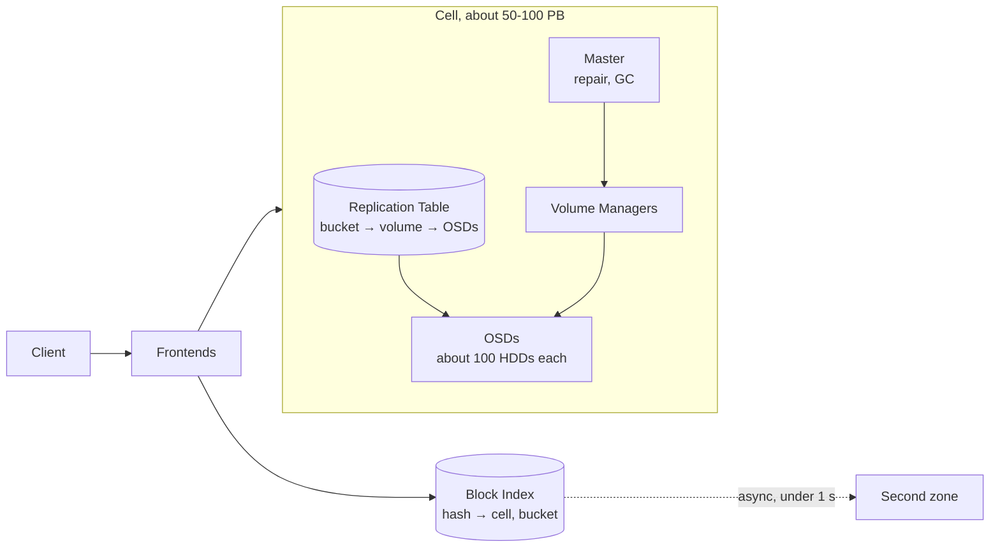
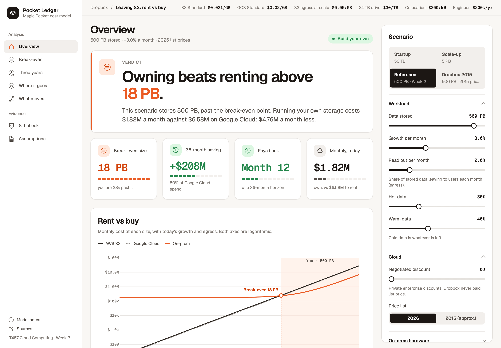
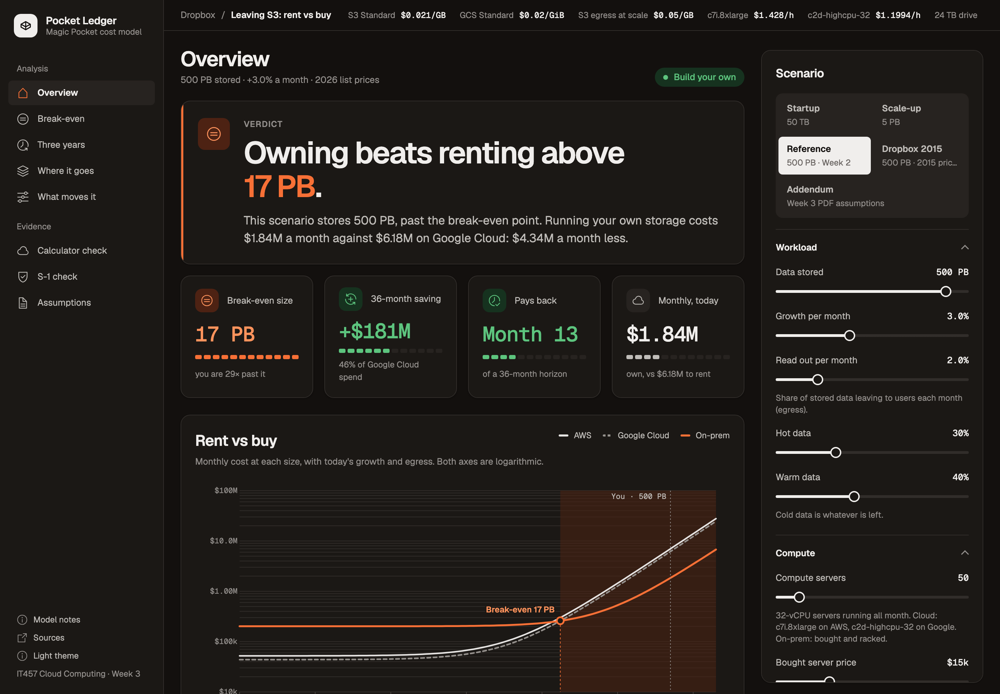
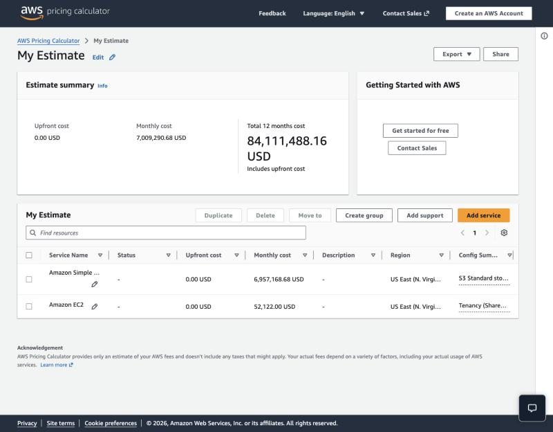
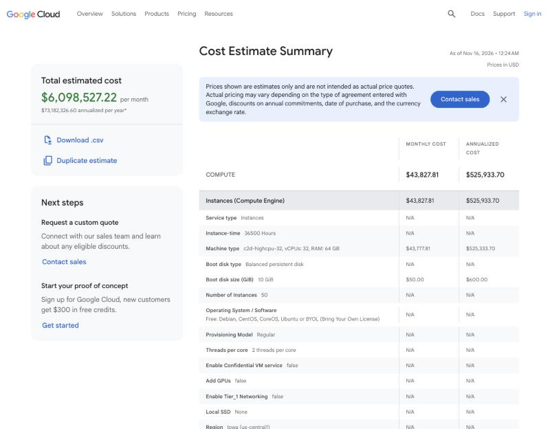
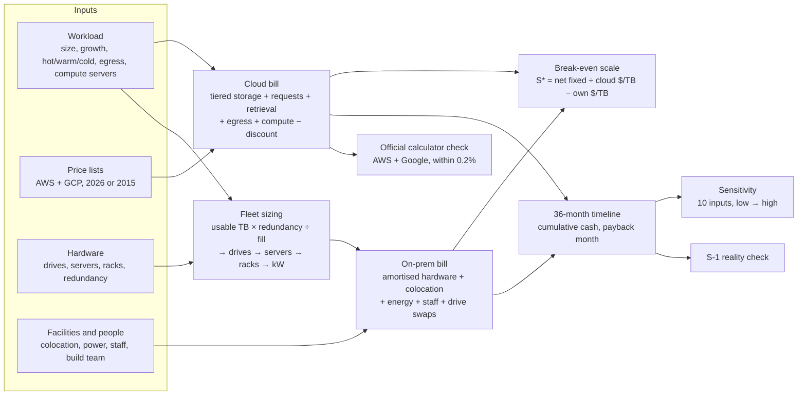
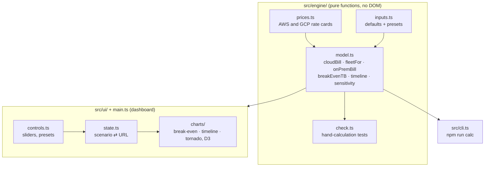

# Dropbox Magic Pocket: repatriation from AWS S3

IT457 Cloud Computing case study, Dhirubhai Ambani University.
Team: 202611054, 202611032, 202611009.

Between 2013 and 2016 Dropbox moved more than 90% of its user files, roughly 600 PB, off
Amazon S3 and onto **Magic Pocket**, a blob store it designed, wrote and runs in leased
co-location space. This repo holds our research notes, the weekly deliverables, and later the
cost model we built to test whether that decision holds up.

## Start here

| If you want to... | Open |
| :--- | :--- |
| Read the Week 1 brief (sources and salient points) | [docs/week1/IT457_Week1_MagicPocket_Brief.pdf](docs/week1/IT457_Week1_MagicPocket_Brief.pdf) |
| Read the Week 2 case analysis report | [docs/Week2/IT457_Week2_Report_Dropbox_MagicPocket.docx.pdf](docs/Week2/IT457_Week2_Report_Dropbox_MagicPocket.docx.pdf) |
| Read the Week 3 results addendum | [docs/Week3/IT457_Week3_Addendum_Dropbox_MagicPocket.pdf](docs/Week3/IT457_Week3_Addendum_Dropbox_MagicPocket.pdf) |
| Play with the cost model | [cost-dashboard/](cost-dashboard/) (`npm install && npm run dev`) |
| Check how the model works, formula by formula | [docs/Week3/model.md](docs/Week3/model.md) |
| See where every price comes from | [docs/Week3/assumptions.md](docs/Week3/assumptions.md) |
| Understand Magic Pocket itself | [docs/architecture.md](docs/architecture.md) |

## The case in five numbers

| | | Source |
| :--- | :--- | :--- |
| Data moved in-house | over 90% of ~600 PB, by 7 Oct 2015 | Dropbox tech blog |
| Infrastructure cost cut | $39.5M (2016) + $35.1M (2017) | S-1 |
| Gross margin | 33% (2015) → 54% → 67% (2017) | S-1 |
| Capex over the same years | about $219M (2015–2017) | S-1 |
| Durability | 12 nines published, 11 committed in the S-1, 27 in Dropbox's own model | blog, S-1 |

The $74.6M "savings" figure that most write-ups quote is the sum of the two S-1 lines above.
It sits in cost of revenue and does not include the capex, which is why the case is still
argued about (see [docs/cost-and-outcomes.md](docs/cost-and-outcomes.md)).

## Why Dropbox left S3

- **One narrow workload.** Immutable blocks up to 4 MB, written once, mostly read while new:
  over 40% of reads hit data less than a day old.
- **Storage was the product.** Storage is most of Dropbox's cost of revenue, so the S3 bill
  effectively set its gross margin.
- **Scale.** About 500 PB by 2015, up from 40 PB in 2012. At that size a dedicated storage team
  and custom hardware pay for themselves.
- **Control.** Owning the stack meant choosing the disk format, erasure code, server density
  and repair policy, none of which S3 exposes.

It was not a full exit. Dropbox still uses AWS for the remaining data and for European
business customers, whose files have been stored on AWS in Germany since 2016.

## Architecture



- Files are split into blocks of up to 4 MB, keyed by SHA-256, packed into 1 GB buckets, which
  are grouped into volumes on storage servers (OSDs).
- New data is replicated four ways. Full volumes are closed and erasure-coded with
  LRC-(12,2,2), about 1.33× overhead.
- Every block is in at least two of three US zones.
- Older data moves to a cold tier: two halves in two regions plus their XOR in a third, which
  saves 25% of disk compared with full cross-region copies.
- Six background verifiers keep checking the data. They account for more than half of all disk
  and database load.

More detail, including the write path and the hardware generations, is in
[docs/architecture.md](docs/architecture.md).

## Week 3: the cost model (Pocket Ledger)

<table>
  <tr>
    <td width="50%"></td>
    <td width="50%"></td>
  </tr>
  <tr>
    <td align="center">Light theme</td>
    <td align="center">Dark theme</td>
  </tr>
</table>

Every section of the dashboard in one image: [full-page capture](docs/Week3/img/dashboard-full.png).

Pocket Ledger is an interactive rent-vs-buy model for Dropbox's workload. It prices the same
workload (storage plus 50 compute servers) on **AWS**, **Google Cloud** and a **Magic Pocket-style
fleet of our own**, then answers four questions:

1. **At what size does owning beat renting?** The break-even scale, where the monthly cost
   curves cross.
2. **When does the investment pay back?** A month-by-month cash simulation with 3% monthly growth,
   an up-front build team, and hardware bought ahead of demand.
3. **How sure are we?** A one-at-a-time sensitivity analysis on ten inputs.
4. **Do the numbers hold up?** Checked against the official AWS and Google Cloud pricing
   calculators (within 0.2%) and against the savings Dropbox reported in its S-1.

### Results for the reference workload (500 PB, +3% a month, 50 compute servers, 2026 list prices)

| | AWS | Google Cloud | Own fleet |
| :--- | ---: | ---: | ---: |
| Monthly cost, month 0 | $7.00M | $6.18M | $1.84M |
| Official calculator, month 0 | $7.01M | $6.18M | |
| 36-month total | $441M | $390M | $209M |

- **Break-even scale: about 17 PB.** Below that, the fixed cost of a storage team and a 2.5-year
  build is larger than what the cloud charges. Above it, owning gets cheaper with every terabyte.
- **Payback: month 13.** Over 36 months, owning saves about **$181M** against the cheaper cloud
  (Google Cloud).
- **Biggest levers:** share of hot data, negotiated cloud discount, egress, redundancy factor and
  drive price. A 40% cloud discount alone cuts the saving to about $25M.
- **Fleet at month 0:** 62,500 drives of 24 TB, 625 storage servers, 50 compute servers, 82 racks,
  810 kW, 19 engineers, $55M of hardware.
- **Calculator check:** Google bills storage per GiB, not per GB. Matching that unit is what brings
  the model to within 0.2% of both calculators ([details](docs/Week3/calculators/README.md)).
- **S-1 check:** at 2015-era prices the model puts S3 for 500 PB at about $100M a year,
  against the $92.5M drop in cloud spend Dropbox reported for 2016. The orders of magnitude agree.

### Checked against the official pricing calculators

We entered the same month-0 workload (500 PB in three storage classes, 165 billion requests,
10 PB out to the internet, 50 compute servers) into both providers' own calculators.

<table>
  <tr>
    <td width="50%"></td>
    <td width="50%"></td>
  </tr>
  <tr>
    <td align="center">AWS: <b>$7,009,291</b> a month<br>model: $6,997,186 (−0.2%)</td>
    <td align="center">Google Cloud: <b>$6,179,527</b> a month*<br>model: $6,179,474 (−0.0%)</td>
  </tr>
</table>

\* Google's calculator caps operations at 10,000 million per line, so the screenshot shows
$6,098,527 with capped request lines. Scaled to the full request volume, the total is $6,179,527.
Every line item and the other nine screenshots are in
[docs/Week3/calculators/](docs/Week3/calculators/README.md).

The Week 3 addendum PDF uses leaner assumptions (all data in S3 Standard, no egress, 1.4×
redundancy, no build team). The dashboard's **Addendum** preset reproduces it ($55M on-prem against
the PDF's $54M), and [docs/Week3/README.md](docs/Week3/README.md) explains every difference.

### How the model works



Every formula, with a worked example, is in [docs/Week3/model.md](docs/Week3/model.md).

### How the code is built

One cost engine, written as pure TypeScript functions with no UI code, is shared by a
command-line calculator and the web dashboard, so both always give the same numbers.



The dashboard keeps the whole scenario in the URL, so a configuration can be bookmarked or sent
to someone and it opens exactly as it was.

## Migration timeline

| When | What |
| :--- | :--- |
| Summer 2013 | Project starts |
| Aug 2014 | Dark launch: writes go to both S3 and Magic Pocket |
| 27 Feb 2015 | Magic Pocket starts serving users |
| 30 Apr 2015 | Bulk transfer ("BASE Jump") begins, peaks above 0.5 Tb/s |
| 7 Oct 2015 | 90% of data served in-house, three weeks ahead of target |
| Q4 2016 | Last duplicate copies on S3 removed |

Full timeline up to 2026: [docs/timeline.md](docs/timeline.md).

## Project plan

| Week | Work | Deliverable | Status |
| :--- | :--- | :--- | :--- |
| 1 | Find primary sources; extract architecture, cost and outcome data | [Brief (PDF)](docs/week1/IT457_Week1_MagicPocket_Brief.pdf) | Done |
| 2 | Case analysis: architecture, problem, solution | [10-page report](docs/Week2/IT457_Week2_Report_Dropbox_MagicPocket.docx.pdf) | Done |
| 3 | Cost and repatriation exercise: price the workload on two clouds, build an on-prem TCO, break-even and sensitivity | [Addendum](docs/Week3/IT457_Week3_Addendum_Dropbox_MagicPocket.pdf), [spreadsheet](docs/Week3/TCO_model.xlsx), [dashboard](cost-dashboard/) | Done |
| 4 | Final report | Report | Next |
| 5 | Viva | Live dashboard demo ([script](docs/Week3/dashboard.md)) | |

## Repository layout

```
.
├── README.md                       you are here
├── docs/
│   ├── architecture.md             Magic Pocket components, write path, redundancy, hardware
│   ├── cost-and-outcomes.md        S-1 and 10-K numbers, and the a16z vs Quinn debate
│   ├── timeline.md                 2007 to 2026
│   ├── sources.md                  annotated sources with links
│   ├── week1/                      Week 1 brief (PDF + LaTeX source) and first draft
│   ├── Week2/                      Week 2 case analysis report and its diagrams
│   └── Week3/
│       ├── README.md               what the guide asks for and where we answer it
│       ├── model.md                the cost model from first principles
│       ├── assumptions.md          every price and constant, with source and confidence
│       ├── dashboard.md            what each dashboard section shows, and the viva script
│       ├── IT457_Week3_Addendum_Dropbox_MagicPocket.pdf
│       ├── TCO_model.xlsx          line-item spreadsheet behind the addendum
│       ├── week3_charts.png
│       ├── calculators/            AWS and Google Cloud calculator estimates, screenshots, comparison
│       └── img/                    dashboard screenshots
└── cost-dashboard/                 Pocket Ledger: cost engine, CLI and dashboard
    ├── README.md                   how to run it, and how the code is organised
    ├── index.html
    └── src/
        ├── engine/                 pure cost model (prices, inputs, model, checks)
        ├── cli.ts                  command-line calculator
        ├── main.ts                 dashboard page and section renderers
        └── ui/                     controls, state, charts, icons, styles
```

## Running the dashboard

Needs Node 20.19 or newer (Vite 8 does not run on Node 18).

```bash
cd cost-dashboard
npm install
npm run dev      # open the URL it prints
npm run calc     # same model in the terminal
npm run check    # engine tests
```

More options are in [cost-dashboard/README.md](cost-dashboard/README.md).

## Building the Week 1 PDF

The brief uses the `tufte-handout` class.

```bash
cd docs/week1
tectonic IT457_Week1_MagicPocket_Brief.tex
```

`pdflatex` or `latexmk` work too if the `tufte-latex` package is installed.

## Main sources

- Dropbox tech blog: [Scaling to exabytes and beyond](https://dropbox.tech/infrastructure/magic-pocket-infrastructure) (2016),
  [Inside the Magic Pocket](https://dropbox.tech/infrastructure/inside-the-magic-pocket) (2016),
  [Pocket watch](https://dropbox.tech/infrastructure/pocket-watch) (2016),
  [Cold storage](https://dropbox.tech/infrastructure/how-we-optimized-magic-pocket-for-cold-storage) (2019)
- Dropbox [Form S-1](https://www.sec.gov/Archives/edgar/data/0001467623/000119312518055809/d451946ds1.htm) (2018)
- F. Agriel, [QCon SF 2022 talk, InfoQ write-up](https://www.infoq.com/articles/dropbox-magic-pocket-exabyte-storage/) (2023)

All 16 sources, with what we used each one for: [docs/sources.md](docs/sources.md).
Cost-model prices (AWS, GCP, drives, colocation, power) are sourced separately in
[docs/Week3/assumptions.md](docs/Week3/assumptions.md).

## Credits

Dashboard icons are from UI Essentials Pro by Pictomate, used under its Standard License. They are
embedded in [`cost-dashboard/src/ui/icons.ts`](cost-dashboard/src/ui/icons.ts) for this project only
and are not offered as a reusable icon set. Fonts: Geist and Geist Mono (SIL Open Font License).
