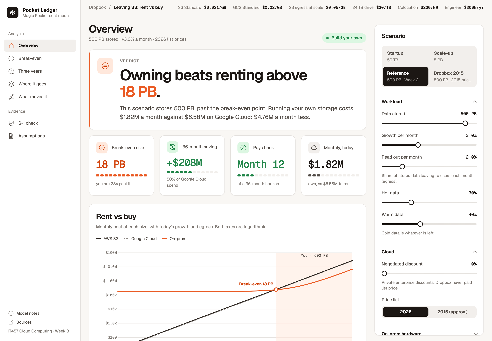
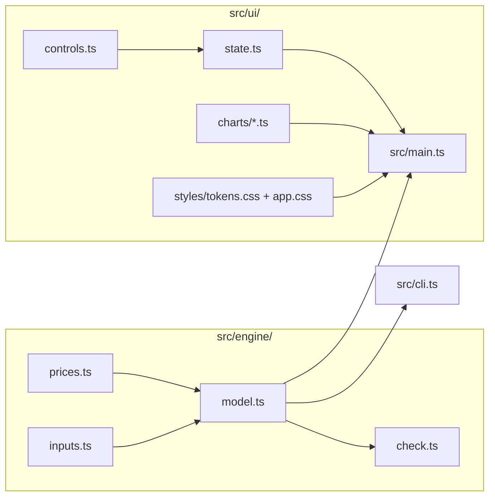

# Pocket Ledger

An interactive rent-vs-buy cost model for Dropbox's move off AWS S3. It prices the same storage
on AWS, Google Cloud and a Magic Pocket-style fleet of your own (storage plus a fixed fleet of
compute servers), and shows where owning
starts to win, when it pays back, what moves the answer, and how the numbers compare with
Dropbox's S-1.

Theme 3 (Cost and repatriation) deliverable for IT457. The model is explained in
[docs/Week3/model.md](../docs/Week3/model.md) and every price is sourced in
[docs/Week3/assumptions.md](../docs/Week3/assumptions.md).



## Run it

Needs Node 20.19 or newer (Vite 8 does not run on Node 18).

```bash
npm install
npm run dev        # dashboard; open the URL Vite prints (http://localhost:5173 by default)
npm run calc       # the same model in the terminal, reference workload (500 PB)
npm run check      # engine tests against hand calculations
npm run build      # type-check, then build a static site into dist/
npm run preview    # serve the built site
```

### Command-line calculator

```bash
npm run calc -- --preset startup                    # 50 TB
npm run calc -- --preset scaleup                    # 5 PB
npm run calc -- --preset dropbox2015                # 500 PB at 2015-era prices and hardware
npm run calc -- --preset addendum                   # the Week 3 addendum PDF's assumptions
npm run calc -- --computeServers 200                # more compute
npm run calc -- --storedTB 20000 --discountPct 25   # any input by name
```

It prints the monthly cost table, the fleet size, break-even scale, payback month, the five
biggest sensitivities and the S-1 comparison.

## What the dashboard shows

| Section | Question it answers |
| :--- | :--- |
| Overview | Verdict for this scenario, break-even size, 36-month saving, payback month, monthly cost |
| Break-even | Monthly cost against size for all three options (log-log), and the formula S* = fixed ÷ (cloud $/TB − own $/TB) worked through with this scenario's numbers |
| Three years | Cumulative cash month by month, with hardware purchases and the payback point |
| Where it goes | Each option's monthly bill split into its parts, on one shared scale |
| What moves it | Tornado chart: each of ten inputs moved alone from low to high |
| Calculator check | The reference workload in the official AWS and Google Cloud calculators next to the model, line by line |
| S-1 check | Model output at 2015 and 2026 prices, storage only, next to the figures in Dropbox's S-1 |
| Assumptions | Every input with its value, confidence (H/M/L) and source link |
| Scenario panel | Five presets (Startup, Scale-up, Reference, Dropbox 2015, Addendum) plus every input as a slider; the scenario is saved in the URL |
| Theme | Light and dark, following the system; the rail has a toggle |

## How the code is organised



```
src/
├── engine/                 pure cost model, no DOM; shared by the CLI and the dashboard
│   ├── prices.ts           AWS and GCP unit prices (2026 from the calculators, approximate 2015), billing units
│   ├── inputs.ts           every input with its documented default, plus the four presets
│   ├── model.ts            cloud bill, fleet sizing, on-prem bill, break-even, timeline, sensitivity
│   └── check.ts            checks against hand calculations (npm run check)
├── cli.ts                  command-line calculator (npm run calc)
├── main.ts                 page layout and the renderer for each section
└── ui/
    ├── state.ts            scenario store, synced to the URL
    ├── controls.ts         scenario panel: presets, sliders, toggles, share link
    ├── format.ts           money, size and percentage formatting
    ├── icons.ts            the icons the interface uses (licensed, see below)
    ├── charts/
    │   ├── frame.ts        responsive redraw, line draw-in animation, tooltip
    │   ├── breakeven.ts    log-log cost curves with the break-even point
    │   ├── timeline.ts     cumulative cash and hardware purchases
    │   └── tornado.ts      sensitivity tornado
    └── styles/
        ├── tokens.css      design tokens: colours (OKLCH), type scale, spacing, radii, motion
        └── app.css         layout and components
```

**Changing a price or default:** edit `src/engine/prices.ts` or `src/engine/inputs.ts`, run
`npm run check`, and record the source in `docs/Week3/assumptions.md`.

**Adding an input to the panel:** add the field to `Inputs` and `DEFAULTS` in `inputs.ts`, use it
in `model.ts`, then add one line to the matching group in `src/ui/controls.ts`.

## Stack

Vite and TypeScript, D3 modules for scales and shapes, Geist and Geist Mono fonts. No framework.
It respects `prefers-reduced-motion` and works down to a 375 px wide phone.

## Credits

Icons are from UI Essentials Pro by Pictomate, used under its Standard License. They are embedded in
`src/ui/icons.ts` for this project only and are not offered as a reusable icon set. Geist and Geist
Mono are under the SIL Open Font License.
