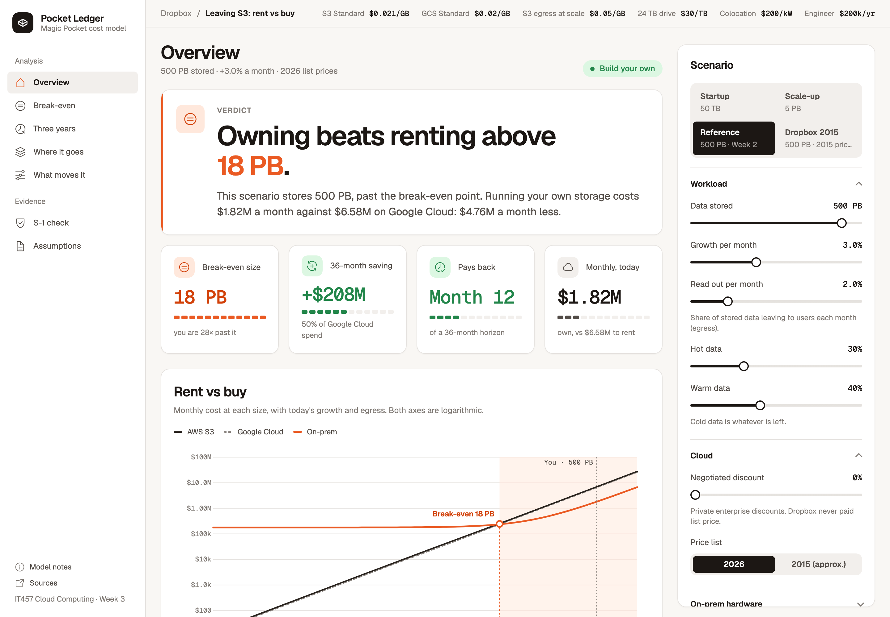
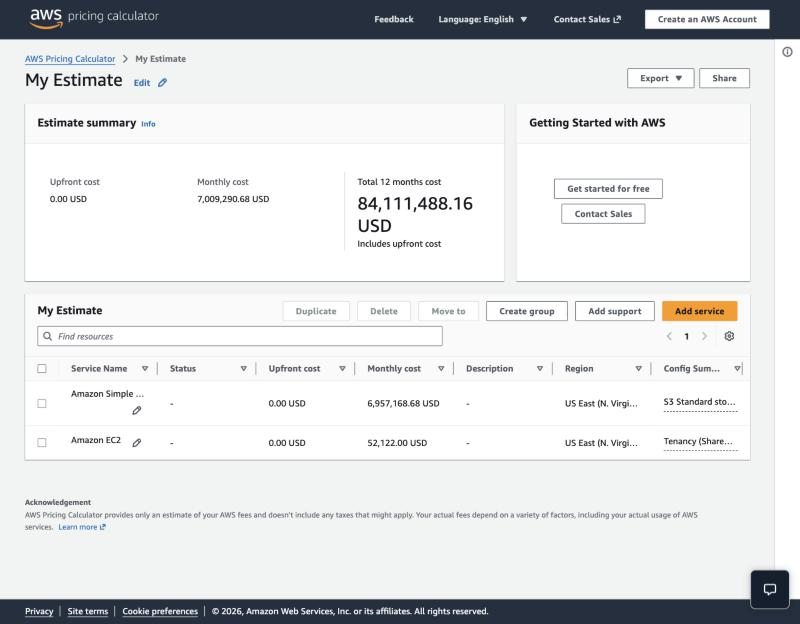
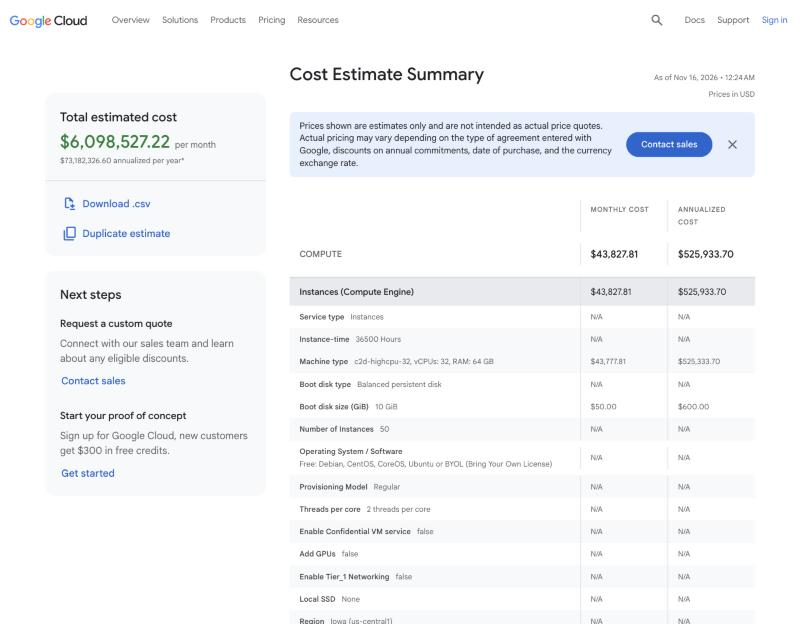

# Week 3: Cost and repatriation exercise

Theme 3 of the implementation guide (Dropbox, Basecamp, Meesho). The grade depends on the cost
model and how well it is measured and explained, not on application features.

## What the guide asks for, and where we answer it

| Guide deliverable | Our answer | Where |
| :--- | :--- | :--- |
| Programmatic cost-calculator script or interactive dashboard | One TypeScript cost engine, used by both a CLI script and a web dashboard | `cost-dashboard/src/engine/`, `npm run calc`, `npm run dev` |
| Architectural cost model comparing two cloud providers | AWS vs Google Cloud, priced line by line (storage tiers, requests, retrieval, egress, compute, discounts) and checked against both official calculators | [model.md](model.md), dashboard "Breakdown" |
| Break-even analysis against an on-premises estimate | Break-even by scale (TB at which owning wins) and by time (month the cumulative cost lines cross) | [model.md](model.md) §4, dashboard "Break-even" |
| Official pricing calculators used (step 2) | The reference workload (500 PB + 50 compute servers) entered into the AWS and Google Cloud calculators; both totals agree with our engine to within 0.2 % | [calculators/](calculators/README.md), dashboard "Calculator check" |
| On-prem hardware priced (step 3) | Drives, servers, racks, colocation, power, transit, staff, build team, each with a source | [assumptions.md](assumptions.md) |

<table>
  <tr>
    <td width="50%"></td>
    <td width="50%"></td>
  </tr>
  <tr>
    <td align="center">AWS calculator: $7.01M a month (model $7.00M)</td>
    <td align="center">Google Cloud calculator: $6.18M a month (model $6.18M)</td>
  </tr>
</table>

It also covers the Week 2 report's promises: 3-year TCO, sensitivity on utilisation, drive prices and
egress, and reconciling the model with the S-1 savings.

## Reference workload (from the Week 2 report, Table 4)

- 500 PB stored at month 0, growing 3 % per month
- Read:write ratio about 10:1, blocks up to 4 MB
- Durability across regions (2 copies across zones, erasure coded inside a zone)
- 3-year horizon, hardware amortised over 4 years
- 4 FTE storage operations at the start
- 50 always-on 32-vCPU compute servers (the guide's "50 high-compute servers")

Smaller presets (50 TB startup, 5 PB scale-up) are included so the break-even crossing is visible.
At 500 PB on its own, owning wins by a wide margin, so the interesting part is *where* it starts to win.

## Files in this folder

- [model.md](model.md): the cost model from first principles, every formula
- [assumptions.md](assumptions.md): every price and constant, with source, date and confidence
- [dashboard.md](dashboard.md): what the dashboard shows, in what order, and how to present it in the viva
- [IT457_Week3_Addendum_Dropbox_MagicPocket.pdf](IT457_Week3_Addendum_Dropbox_MagicPocket.pdf): the results addendum for the report
- [TCO_model.xlsx](TCO_model.xlsx): line-item spreadsheet behind the addendum
- [week3_charts.png](week3_charts.png): charts used in the addendum
- [img/](img/): dashboard screenshots
- The dashboard itself: [../../cost-dashboard/](../../cost-dashboard/)

## The addendum and the dashboard: why the numbers differ

The addendum PDF and the dashboard answer the same question with different assumptions. The
dashboard's **Addendum** preset loads the addendum's assumptions, and then the two agree:

| 36-month total | Addendum PDF | Dashboard, Addendum preset | Dashboard, Reference |
| :--- | ---: | ---: | ---: |
| AWS | $698M | $673M | $441M |
| Google Cloud | $864M (multi-region) | $598M (regional) | $390M |
| On-prem | $53.8M | $55.5M | $209M |
| Break-even size | "about 38 PB" | 2.8 PB | 17 PB |

What the Reference scenario does differently, and why:

| Assumption | Addendum | Reference | Why the reference is closer to Dropbox |
| :--- | :--- | :--- | :--- |
| Storage classes | all 500 PB in Standard | 30 % Standard, 40 % IA/Nearline, 30 % Glacier IR/Coldline | most Dropbox reads hit recent data, so a real cloud bill would tier |
| Data read out | none | 2 % a month (10 PB) | users download files; egress is the line that punishes the cloud |
| Raw bytes per usable byte | 1.4× (one zone, erasure coded) | 2.4× at 80 % fill, so 3.0× raw | Magic Pocket keeps every block in two zones and leaves disks headroom |
| Drive price | $15 / TB | $30 / TB | 2026 street price for 20–24 TB enterprise drives |
| People | 3 FTE, no build team | 4 FTE + 1 per 100 PB raw (19 at 500 PB), 8 engineers for 2.5 years to build | Dropbox's own build took a team about 2.5 years |
| Google Cloud | multi-region $0.026 | regional $0.020 per GiB | the calculator check used regional, matching AWS's single region |
| Compute | none | 50 servers | the guide's example workload |

Both say the same thing: at 500 PB owning wins by a wide margin. The reference scenario is the
conservative one: it gives the cloud tiering and charges on-prem for a build team and redundancy.
The addendum's "about 38 PB" divides 500 PB by the 13× cost ratio, a shortcut that does not follow
from the cost curves. Searching the curves, as the dashboard does, gives 2.8 PB with the addendum's
own assumptions and 17 PB with the reference ones.

## Build order

1. Engine (pure functions, no UI) plus unit checks against hand calculations
2. CLI: `npm run calc -- --preset reference` prints the cost table and break-even
3. Dashboard on top of the same engine
4. Run the official calculators for the reference workload, compare with the engine, note gaps
5. Results addendum for the report: charts exported from the dashboard plus interpretation
