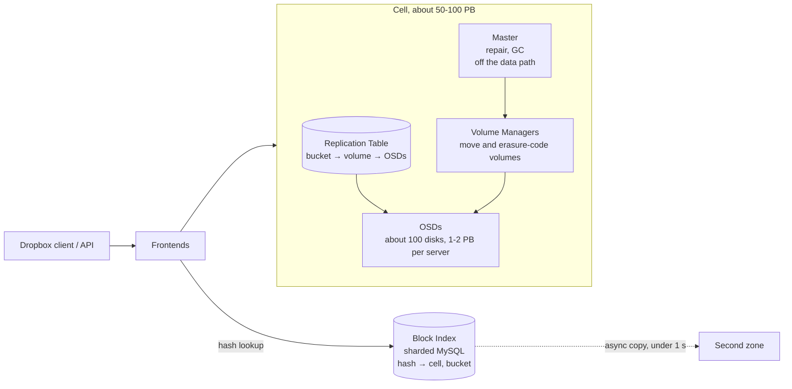

# Magic Pocket architecture

Notes from the primary sources, mainly Cowling's *Inside the Magic Pocket* (2016) and
Agriel's QCon SF 2022 talk. Numbers in square brackets refer to [sources.md](sources.md).

## What it stores

Magic Pocket is a blob store for file *contents* only. File metadata (names, folders,
sharing) lives in separate MySQL-based systems and was never on S3 [1].

| Unit    | Size             | Notes                                                        |
| :------ | :--------------- | :----------------------------------------------------------- |
| Block   | up to 4 MB       | Compressed, encrypted, immutable. Key = SHA-256 of the block |
| Bucket  | 1 GB             | Logical container that blocks are appended to                |
| Volume  | one or more buckets | Placed on a fixed set of OSDs; replicated or erasure-coded |
| Extent  | 1–2 GB on disk   | What a disk actually stores and what gets repaired [10]      |
| Cell    | ~50–100 PB       | Self-contained cluster; one Master per cell caps its size [2]|
| Zone    | many cells       | Three US zones: west, central, east                          |

## Components

- **Frontends** accept puts and gets, look up the Block Index, and talk to the right cell.
- **Block Index** maps a block hash to its cell, bucket and checksum. It is one large sharded
  MySQL cluster [2].
- **Replication Table** (per cell) maps bucket to volume, and volume to its OSDs, open/closed
  state, type and generation. Small enough to sit in memory [2].
- **Master** schedules repair, garbage collection and other background work. It is not on the
  read or write path, so a Master outage does not stop traffic [2].
- **Volume Managers** do the heavy lifting: copying volumes during repair and re-encoding
  closed volumes. They run on the storage hardware.
- **OSDs** are deliberately simple storage servers. Since 2018 they write directly to SMR
  drives with no filesystem [5].

## Write path

1. Client uploads a block; a Frontend hashes it and picks an open volume in a cell.
2. The block is written to a volume that is replicated four ways inside the cell [10].
3. The Block Index records hash → cell, bucket.
4. A cross-zone daemon copies the block to a second zone, usually within one second [2].
5. When the volume fills it is closed and later erasure-coded in the background.

## Redundancy schemes

| Data state                | Scheme                                     | Storage overhead |
| :------------------------ | :----------------------------------------- | :--------------- |
| New writes (open volumes) | 4× replication inside the cell             | 4×               |
| Closed volumes            | LRC-(12,2,2), tolerates any 3 failures in a group | about 1.33× [10] |
| For comparison            | Reed–Solomon (6,3)                         | 1.5×             |
| Cold tier (2019)          | 2 fragments + XOR parity across 3 regions  | 1.5× vs 2× before, 25% less disk [4] |

The LRC family comes from Microsoft's Azure Storage paper (Huang et al., USENIX ATC 2012).
For the cold tier Dropbox looked at Facebook's f4 design and an erasure code spanning regions,
and dropped both for complexity; the cross-region attempt was killed after nine months [4].

## Durability is checked, not assumed

A Markov model of disk failures and repair times gives 27 nines of durability. Dropbox
publishes 12, and the S-1 commits to 11, because models do not cover software bugs or
operator error [3]. Six verifiers run all the time:

| Verifier            | What it does                                                       |
| :------------------ | :----------------------------------------------------------------- |
| Cross-zone Verifier | Walks the file journal and checks every block is in the right zones |
| Storage Watcher     | Re-reads a 1% sample of new blocks after 1 min, 1 h, 1 day, 1 week, 1 month |
| Metadata Scanner    | Checks Block Index entries against the OSDs, about 1M blocks/s, full pass weekly |
| Disk Scrubber       | Reads every disk every 1–2 weeks and checks checksums              |
| Extent Referee      | Confirms every deleted extent was justified by the logs            |
| Trash Inspector     | Confirms trash holds only deleted or already-moved blocks          |

Over half of all disk and database load is this internal verification [3]. At current scale
there are hundreds of hardware failures a day, and about four extents are repaired every
second against a 48-hour repair SLA [10].

## Hardware over time

- **2015–2016:** custom "Diskotech" storage servers, over 1 PB per machine and over 8 PB per
  rack [2]. The disk-facing service was rewritten from Go to Rust to cut memory use [11].
- **2018:** first large company to deploy SMR drives at scale; about 20% more capacity per
  drive at roughly the same cost [5].
- **4th → 6th generation:** five fewer megawatts and a third of the rack space per exabyte [5].
- **7th generation (2025):** drives of up to 32 TB, over 99% of the fleet on SMR, 200 Gb/s
  throughput target per storage server, rack power doubled by moving to four PDUs [6].
- **2025:** HAMR drives qualified without new racks [16].
